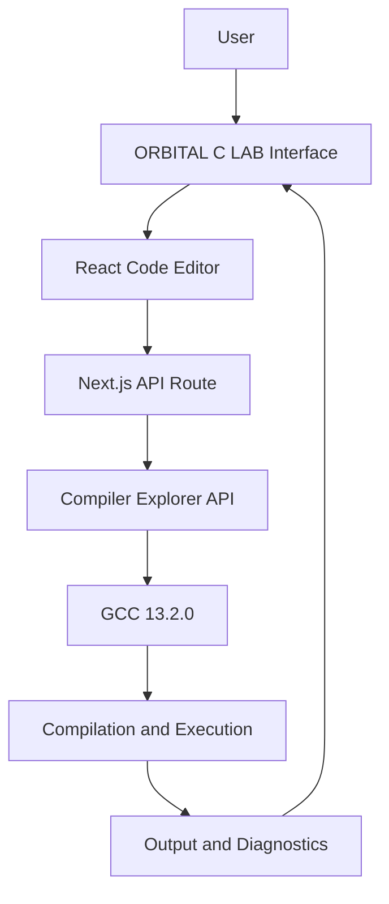

# 🚀 ORBITAL C LAB – Online C Compiler

<p align="center">
  <strong>An Interactive Online C Programming & Compilation Workspace</strong>
</p>

<p align="center">
  <a href="https://www.aigravity.bond/">
    
  </a>
  
  
  
  
</p>

## 🌌 Overview

**ORBITAL C LAB** is a browser-based C programming environment designed to provide an interactive workspace for writing, compiling, and executing C programs without requiring a locally installed compiler.

The application combines a modern code editor, real-time compilation workflow, program input management, execution output, and a browser-based program library.

Built using Next.js, React, TypeScript, and Tailwind CSS, the platform connects to the Compiler Explorer (Godbolt) API to compile and execute C programs using GCC 13.2.0.

The project focuses on making C programming more accessible through an intuitive interface and a streamlined development experience.

**🔗 Live Application:** https://www.aigravity.bond/

---

## ✨ Key Features

### 1. Interactive Code Editor
- C programming code editor with syntax highlighting.
- Line numbering and cursor position tracking.
- Automatic indentation and tab support.
- Copy source code functionality.
- Reset code to the default example.
- Keyboard shortcuts for faster coding.

### 2. Real C Compilation and Execution
- Compile and execute C programs online.
- Powered by GCC 13.2.0.
- Integrated Compiler Explorer API.
- Displays compiler warnings and errors.
- Displays program output and runtime errors.
- Execution duration display.
- Handles compilation failures and execution timeouts.

### 3. Standard Input Management
- Dedicated standard input (stdin) panel.
- Supports programs that require user input.
- Input detection for common C input functions.
- Allows source code and standard input to be saved together.

### 4. Program Library
- Save programs directly in the browser.
- Rename existing programs.
- Maintain a history of saved programs.
- Search saved programs.
- Open previously saved programs.
- Delete saved programs.
- Download C source files.
- Save associated standard input with programs.

### 5. Automatic Draft Recovery
- Automatically saves editor drafts.
- Restores recent code and input after reopening.
- Draft expiration after 15 minutes.

### 6. Example Programs

The application includes ready-to-use C examples:

- Hello, World
- Read Input using scanf
- Fibonacci Sequence
- Pointers and Arrays

These examples help beginners explore fundamental C programming concepts.

### 7. Productivity Features
- Keyboard shortcut: `Ctrl + Enter` / `Cmd + Enter` to execute code.
- Keyboard shortcut: `Ctrl + S` / `Cmd + S` to save programs.
- Resizable editor and output panels.
- Responsive workspace interface.
- Dark-themed orbital-inspired visual design.

---

## 🛠️ Technology Stack

| Technology | Purpose |
|---|---|
| Next.js 16.3 | Full-stack React framework |
| React 19 | User interface development |
| TypeScript | Type-safe application development |
| Tailwind CSS 4 | Styling and responsive design |
| GCC 13.2.0 | C compilation and execution |
| Compiler Explorer API | Remote compilation service |
| Lucide React | Interface icons |
| Vercel Analytics | Website analytics |

### Architecture

The application uses a frontend-to-backend API architecture.



### Compilation Workflow

1. The user writes C source code in the editor.
2. Optional standard input is provided.
3. The frontend sends the code and input to the Next.js API route.
4. The API route forwards the request to Compiler Explorer.
5. GCC 13.2.0 compiles and executes the program.
6. Compilation diagnostics and execution results are returned.
7. The interface displays the output, warnings, or errors.

The compilation request uses optimization and warning flags:

```bash
-O2 -Wall
```

The API route also implements a 25-second request timeout.

---

## 💾 Data Storage

ORBITAL C LAB uses browser-based storage for its program management features.

- **LocalStorage:** Stores saved programs and associated standard input.
- **Draft Recovery:** Stores recent editor code and input.
- **No separate application database:** The provided source code does not implement a dedicated database service.

Saved programs remain in the browser where they were created. Clearing browser data can remove locally stored programs, so downloading backups is recommended.

---

## 🚀 Getting Started

### Prerequisites

Make sure you have installed:

- Node.js
- pnpm package manager
- Git

### 1. Clone the Repository

```bash
git clone https://github.com/YOUR-USERNAME/orbital-c-lab.git
```

### 2. Navigate to the Project

```bash
cd orbital-c-lab
```

### 3. Install Dependencies

```bash
pnpm install
```

### 4. Start the Development Server

```bash
pnpm dev
```

### 5. Open in Browser

Visit:

```text
http://localhost:3000
```

The application uses the public Compiler Explorer API for compilation and execution, so an internet connection is required.

---

## 🎯 Project Objectives

- Make C programming accessible through a browser-based environment.
- Simplify the compilation and execution workflow.
- Provide an interactive workspace for programming practice.
- Help beginners experiment with C programming examples.
- Improve productivity through program saving and input management.

---

## 🧑‍💻 Development & Contribution

This project was developed as an individual initiative with AI-assisted development (vibe coding).

**My contributions include:**

- Designing the application's user interface and overall visual experience.
- Using AI-assisted development workflows to build the application.
- Working with the application structure and component integration.
- Developing an understanding of frontend-to-backend communication and compiler API integration.
- Exploring the practical implementation of an online programming environment.

The project provided an opportunity to explore modern web development technologies and understand how external compilation services can be integrated into an interactive application.

---

## 🔮 Future Improvements

Potential enhancements include:

- Support for additional programming languages such as C++, Java, and Python.
- Improved editor features and code navigation.
- Persistent cloud-based program storage.
- User accounts and authentication.
- Enhanced compilation history.
- Additional programming examples and learning resources.
- Improved accessibility and mobile editing experience.

---

## ⚠️ Limitations

- Compilation depends on the availability of the external Compiler Explorer service.
- Saved programs are stored locally in the browser rather than in cloud storage.
- An internet connection is required for compilation and execution.
- The project currently focuses on C programming.

---

## 🌐 Live Demo

**Try ORBITAL C LAB here:**

[https://www.aigravity.bond/](https://www.aigravity.bond/)

---

## 👨‍💻 Developer

**Aditya Raj Verma**

BCA – Data Science Student  
Xavier University, Patna

- LinkedIn: https://www.linkedin.com/in/aditya-rajverma/
- GitHub: https://github.com/aditya-rajverma

---

<p align="center">
  <strong>ORBITAL C LAB</strong>
  <br />
  <i>Write. Compile. Execute. Explore.</i>
  <br /><br />
  Built with curiosity and AI-assisted development.
</p>
